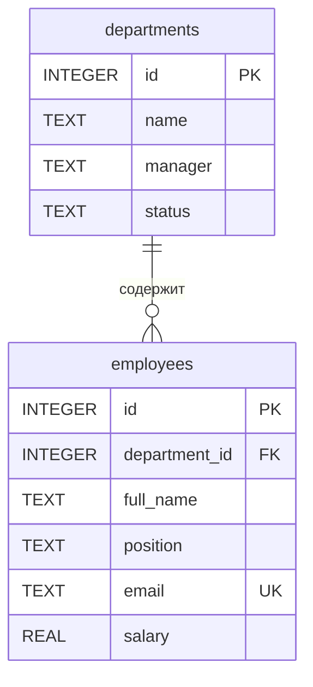

# Справочник сотрудников

Тема №25: **Справочник сотрудников**. Backend-сервис для хранения отделов компании и сотрудников этих отделов.

| | |
| --- | --- |
| Главная сущность | Отдел |
| Связанная сущность (1:N) | Сотрудник |
| Фишка темы (лабораторная ★★) | Глобально уникальный email сотрудника и статистика по отделам — **реализованы** |
| Стек | Python 3.10+, FastAPI, Pydantic, Uvicorn, SQLite (`sqlite3`), Alembic и SQLAlchemy (для миграций) |

## Как запустить

```bash
# 1. Клонировать репозиторий и перейти на ветку лабораторной 2
# (после того как изменения будут добавлены в ветку lab-2)
git clone https://github.com/NiAntiSimuS/backend_Muravskii_employees.git
cd backend_Muravskii_employees
git switch lab-2

# 2. Установить зависимости
python -m pip install -r requirements.txt

# 3. Скопировать пример конфигурации
cp .env.example .env

# 4. Загрузить переменные из .env (Linux/macOS)
set -a
. ./.env
set +a

# 5. Применить миграции (при старте они также запускаются автоматически)
python -m alembic upgrade head

# 6. По желанию заполнить пустую базу тестовыми данными
python -m app.seed

# 7. Запустить сервер
python -m uvicorn app.main:app --host 127.0.0.1 --port 8000 --no-access-log
```

В PowerShell для настройки окружения и запуска выполните:

```powershell
$env:DATABASE_URL = "sqlite:///./employees.db"
python -m alembic upgrade head
python -m app.seed
python -m uvicorn app.main:app --host 127.0.0.1 --port 8000 --no-access-log
```

Сервис работает на `http://localhost:8000`. Swagger UI — `http://localhost:8000/docs`, проверка сервиса — `http://localhost:8000/health`.

`DATABASE_URL` задаёт строку подключения к файлу SQLite. Если переменная не указана, используется `sqlite:///./employees.db` (путь относительно текущего каталога). Для абсолютного пути: `sqlite:////tmp/employees.db`. Файл БД и таблицы `departments`, `employees` создаются миграциями Alembic. При запуске приложения `app/database.py` автоматически выполняет `alembic upgrade head`; запускать SQL вручную не требуется. `app/schema.sql` сохранён как справочная копия SQL-схемы; приложение его не исполняет. Файл `.env` и `*.db` игнорируются Git, а `.env.example` можно коммитить.

### Проверка сохранности данных

1. Создать отдел и сотрудника через API (см. `requests.http`).
2. Остановить Uvicorn и запустить снова **из того же каталога и с тем же `DATABASE_URL`**.
3. Выполнить `GET /api/departments` и `GET /api/departments/{id}/employees` — записи останутся в SQLite.

## Структура проекта

```text
app/
├── __init__.py
├── database.py     # соединение SQLite, Unicode-поиск, вызов Alembic
├── schema.sql      # справочная копия SQL-схемы
├── seed.py          # команда заполнения пустой базы
├── main.py         # FastAPI-приложение, логирование, обработка ошибок, Swagger
├── models.py       # Pydantic-схемы и валидация отделов/сотрудников
├── repository.py   # параметризованные SQL-операции для двух сущностей
└── routes.py       # HTTP-маршруты
migrations/
├── env.py          # Alembic подключается к DATABASE_URL
└── versions/
    ├── 0001_initial_schema.py            # создание таблиц
    ├── 0002_employee_department_index.py # индекс сотрудников
    └── 0003_unique_employee_email.py    # уникальность email
alembic.ini         # конфигурация Alembic
```

## Эндпоинты

| Метод | Путь | Что делает | Ответ |
| --- | --- | --- | --- |
| GET | `/health` | Проверка сервиса | 200 `{"status":"ok"}` |
| POST | `/api/departments` | Создать отдел | 201, объект с `id`; 400 при ошибке |
| GET | `/api/departments` | Список отделов, поиск `q` | 200 |
| GET | `/api/departments/stats` | Агрегированная статистика по отделам | 200 |
| GET | `/api/departments/{id}` | Получить отдел | 200; 404 |
| PATCH | `/api/departments/{id}` | Изменить отдел | 200; 400; 404 |
| DELETE | `/api/departments/{id}` | Удалить отдел и его сотрудников | 204; 404 |
| POST | `/api/departments/{id}/employees` | Создать сотрудника в отделе | 201 с `department_id`; 400; 404; **409 при повторном email** |
| GET | `/api/departments/{id}/employees` | Получить сотрудников отдела | 200, массив; 404 |

### Поля отдела

```json
{
  "id": 1,
  "name": "Разработка",
  "manager": "Анна Смирнова",
  "status": "active"
}
```

- `name` — обязательное непустое название отдела (до 100 символов);
- `manager` — обязательное непустое имя руководителя (до 100 символов);
- `status` — `active` или `inactive`, по умолчанию `active`;
- `id` — назначается сервером.

### Поля сотрудника

```json
{
  "id": 1,
  "department_id": 1,
  "full_name": "Иван Иванов",
  "position": "Разработчик",
  "email": "ivan@example.com",
  "salary": 90000.0
}
```

Для создания сотрудника отправьте `POST /api/departments/1/employees` с полями `full_name`, `position`, `email` и `salary`. Все четыре поля обязательны; зарплата — неотрицательное число. `id` и `department_id` формирует сервер. При обращении к несуществующему отделу возвращается 404. Email должен быть уникален **среди всех сотрудников**, а не только внутри одного отдела (без учёта регистра ASCII). При повторении email сервер отвечает **409** с `{"error": "Email уже используется другим сотрудником", "field": "email"}`. При удалении отдела сотрудники удаляются каскадно с помощью внешнего ключа `ON DELETE CASCADE`.

### Фильтрация и пагинация

`GET /api/departments` поддерживает `limit` (1–100, по умолчанию 10), `offset` (от 0), `manager` (точное совпадение), `status` (`active`/`inactive`) и `q` — часть названия отдела без учёта регистра. Поиск выполняет SQLite (в том числе для кириллицы). Примеры:

```text
GET /api/departments?limit=10&offset=0
GET /api/departments?manager=Анна%20Смирнова
GET /api/departments?status=active
GET /api/departments?q=РАЗРАБ
GET /api/departments?q=раз&status=active
```

Ошибки валидации по-прежнему возвращаются с HTTP 400 в формате:

```json
{"error": "текст ошибки", "field": "имя поля"}
```

Для SQL-значений используются параметры `?`, а не конкатенация пользовательского ввода. Например, название `'); DROP TABLE departments;--` сохраняется как обычная строка и не удаляет таблицу.

## ★ Миграции, тестовые данные, индекс и поиск

### Миграции Alembic

SQL-схема управляется версионированными миграциями в `migrations/versions/`:

- `0001_initial_schema.py` создаёт `departments` и `employees` (или регистрирует уже существующие таблицы из предыдущего этапа, **не стирая данные**).
- `0002_employee_department_index.py` создаёт `idx_employees_department_id`.
- `0003_unique_employee_email.py` создаёт уникальный индекс `uq_employees_email_nocase`.

Команды запускаются **из корня проекта после настройки `DATABASE_URL`**:

```bash
python -m alembic upgrade head  # применить все миграции
python -m alembic current       # посмотреть текущую версию
python -m alembic history       # история миграций
```

При обычном запуске FastAPI миграции `upgrade head` также применяются автоматически. Созданные отделы и сотрудники сохраняются при переходе с предыдущего SQLite-файла.

### Сиды

```bash
python -m app.seed
```

Если обе таблицы пусты, команда добавляет **2 отдела и 3 сотрудников**. Если в базе уже есть данные, ничего не изменяет; повторное выполнение не создаёт дубликатов. Данные добавляются одной транзакцией. Сиды предназначены для демонстрации, выполнять их на действующей базе не нужно.

### Индекс и реальный EXPLAIN QUERY PLAN

Частый запрос — получить всех сотрудников одного отдела:

```sql
SELECT id, department_id, full_name, position, email, salary
FROM employees
WHERE department_id = 1
ORDER BY id;
```

Для него миграция `0002` создаёт индекс `idx_employees_department_id` по столбцу `employees.department_id`.

Проверить план SQLite можно командой из корня проекта (при необходимости предварительно задайте `DATABASE_URL`):

```bash
python - <<'PY'
from app.database import Database
with Database().connect() as connection:
    sql = """EXPLAIN QUERY PLAN
             SELECT id, department_id, full_name, position, email, salary
             FROM employees WHERE department_id = ? ORDER BY id"""
    for row in connection.execute(sql, (1,)):
        print(tuple(row))
PY
```

**Фактический вывод SQLite после применения миграций:**

```text
(4, 0, 0, 'SEARCH employees USING INDEX idx_employees_department_id (department_id=?)')
```

Слово `SEARCH` и имя индекса подтверждают его использование (числовые поля плана могут отличаться между версиями SQLite).

### Поиск названия отдела

```http
GET /api/departments?q=разраб
GET /api/departments?q=РАЗРАБ
```

Оба запроса находят отдел «Разработка». Фильтр работает внутри SQL через `instr(unicode_casefold(name), unicode_casefold(?)) > 0`; `unicode_casefold` — зарегистрированная в `sqlite3` Unicode-функция. Она необходима, поскольку обычный `NOCASE` у SQLite не выполняет корректное нечувствительное к регистру сравнение русских букв. Ввод передаётся параметром `?`; поиск совместим с `limit`, `offset`, `manager` и `status`.

## ★★ Правило темы и статистика (2 балла)

### Правило: уникальный email сотрудника

`POST /api/departments/{id}/employees` не позволяет создать сотрудника с email,
который уже используется **в любом отделе** (без учёта регистра для ASCII-адресов).
Проверка существования email и добавление записи выполняются **в одной транзакции**
с `BEGIN IMMEDIATE` в `EmployeeRepository.create`. Благодаря блокировке записи
два одновременных запроса не могут оба успешно пройти проверку. Дополнительно
миграция `0003` создаёт уникальный индекс БД `uq_employees_email_nocase`.

Пример: создание сотрудника с `unique@example.com` возвращает `201`;
последующее создание с `UNIQUE@example.com` возвращает `409 Conflict`:

```json
{"error": "Email уже используется другим сотрудником", "field": "email"}
```

Неуспешный запрос не добавляет сотрудника. Проверить поведение можно в
`requests.http` и через `contract.json` (`rule`). Если в старом файле БД уже
есть дублирующиеся email, прежде чем применить миграцию `0003`, устраните их.
Найти дубликаты можно запросом:

```sql
SELECT email COLLATE NOCASE AS email, COUNT(*) AS copies
FROM employees
GROUP BY email COLLATE NOCASE
HAVING COUNT(*) > 1;
```

### Статистика, которую считает SQLite

`GET /api/departments/stats` возвращает массив по всем отделам, включая
отделы без сотрудников. Один SQL-запрос использует `LEFT JOIN`, `GROUP BY`,
`COUNT`, `SUM` и `AVG`, без вычислений в цикле Python:

```sql
SELECT d.id AS department_id, d.name AS department_name,
       COUNT(e.id) AS employee_count,
       COALESCE(SUM(e.salary), 0) AS total_salary,
       COALESCE(AVG(e.salary), 0) AS avg_salary
FROM departments AS d
LEFT JOIN employees AS e ON e.department_id = d.id
GROUP BY d.id, d.name
ORDER BY d.id;
```

Пример ответа для отдела с двумя сотрудниками (90 000 и 80 000):

```json
[
  {
    "department_id": 1,
    "department_name": "Разработка",
    "employee_count": 2,
    "total_salary": 170000.0,
    "avg_salary": 85000.0
  }
]
```

В пустом отделе показатели `employee_count`, `total_salary` и `avg_salary`
равны нулю. В `contract.json` указан `stats_path`.

## ER-диаграмма



`employees.department_id` ссылается на `departments.id`. Один отдел может иметь много сотрудников, каждый сотрудник принадлежит одному отделу. Внешние ключи включаются для каждого соединения SQLite командой `PRAGMA foreign_keys = ON`.

## Интерфейс

Интерфейс и скриншот будут добавлены в лабораторной 4.
