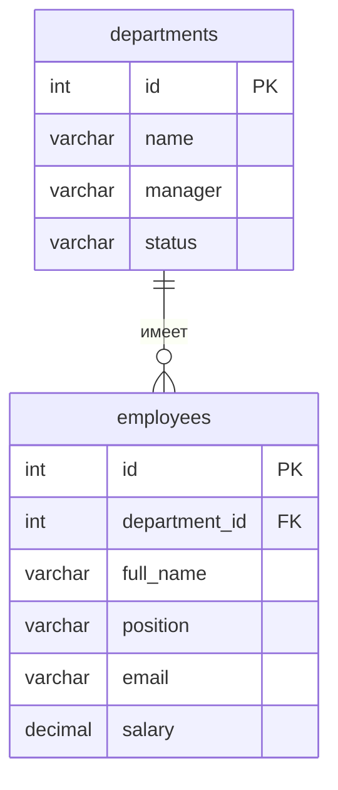

# Справочник сотрудников

Тема №25: **Справочник сотрудников**. Backend-сервис для хранения отделов компании и, начиная со следующих лабораторных, сотрудников этих отделов.

| | |
| --- | --- |
| Главная сущность | Отдел |
| Связанная сущность (1:N) | Сотрудник |
| Фишка | Email сотрудника не может повторяться; статистика — число сотрудников и средняя зарплата по отделам |
| Стек | Python 3.10+, FastAPI, Pydantic, Uvicorn; в лабораторной 1 данные хранятся в памяти |

## Как запустить

```bash
# 1. Клонировать свой репозиторий
# Заменить URL и имя папки на свои.
git clone <URL_ВАШЕГО_РЕПОЗИТОРИЯ>
cd <ИМЯ_РЕПОЗИТОРИЯ>

# 2. Установить зависимости
python -m pip install -r requirements.txt

# 3. Запустить сервис
python -m uvicorn app.main:app --host 127.0.0.1 --port 8000 --no-access-log
```

Сервис работает на `http://localhost:8000`.

Полезные адреса:

- `http://localhost:8000/health` — проверка работы сервиса;
- `http://localhost:8000/docs` — Swagger UI;
- `http://localhost:8000/api/departments` — API отделов.

Запросы для демонстрации лежат в `requests.http`.

## Структура проекта

```text
app/
├── __init__.py
├── main.py       # FastAPI-приложение, роуты, обработка ошибок, Swagger и логирование
├── schemas.py    # Pydantic-схемы и валидация входных данных
└── storage.py    # in-memory хранилище и CRUD-операции
```

В лабораторной 1 данные хранятся только в памяти процесса. После перезапуска сервера список отделов снова становится пустым.

## Эндпоинты

| Метод | Путь | Что делает | Ответ |
| --- | --- | --- | --- |
| GET | `/health` | Проверка, что сервис жив | 200 `{"status":"ok"}` |
| POST | `/api/departments` | Создать отдел | 201 и объект с серверным `id`; 400 при ошибке |
| GET | `/api/departments` | Получить список отделов | 200 |
| GET | `/api/departments/{id}` | Получить один отдел | 200; 404 для неизвестного `id` |
| PATCH | `/api/departments/{id}` | Изменить поля отдела | 200; 400; 404 |
| DELETE | `/api/departments/{id}` | Удалить отдел | 204; 404 |

### Поля отдела

Пример объекта:

```json
{
  "id": 1,
  "name": "Разработка",
  "manager": "Анна Смирнова",
  "status": "active"
}
```

- `name` — обязательное непустое название отдела;
- `manager` — обязательное непустое имя руководителя;
- `status` — `active` или `inactive`, по умолчанию `active`;
- `id` — назначается сервером.

### Фильтрация и пагинация

`GET /api/departments` поддерживает:

- `limit` — количество записей, от 1 до 100;
- `offset` — сколько записей пропустить;
- `manager` — фильтр по руководителю;
- `status` — фильтр по статусу.

Примеры:

```text
GET /api/departments?limit=10&offset=0
GET /api/departments?manager=Анна%20Смирнова
GET /api/departments?status=active
```

Ошибки валидации возвращаются с HTTP 400 в едином формате:

```json
{
  "error": "текст ошибки",
  "field": "имя поля"
}
```

Неизвестный `id` возвращает HTTP 404.

## ER-диаграмма

Связанная сущность появится в лабораторной 2.



## Интерфейс

Интерфейс и скриншот будут добавлены в лабораторной 4.
